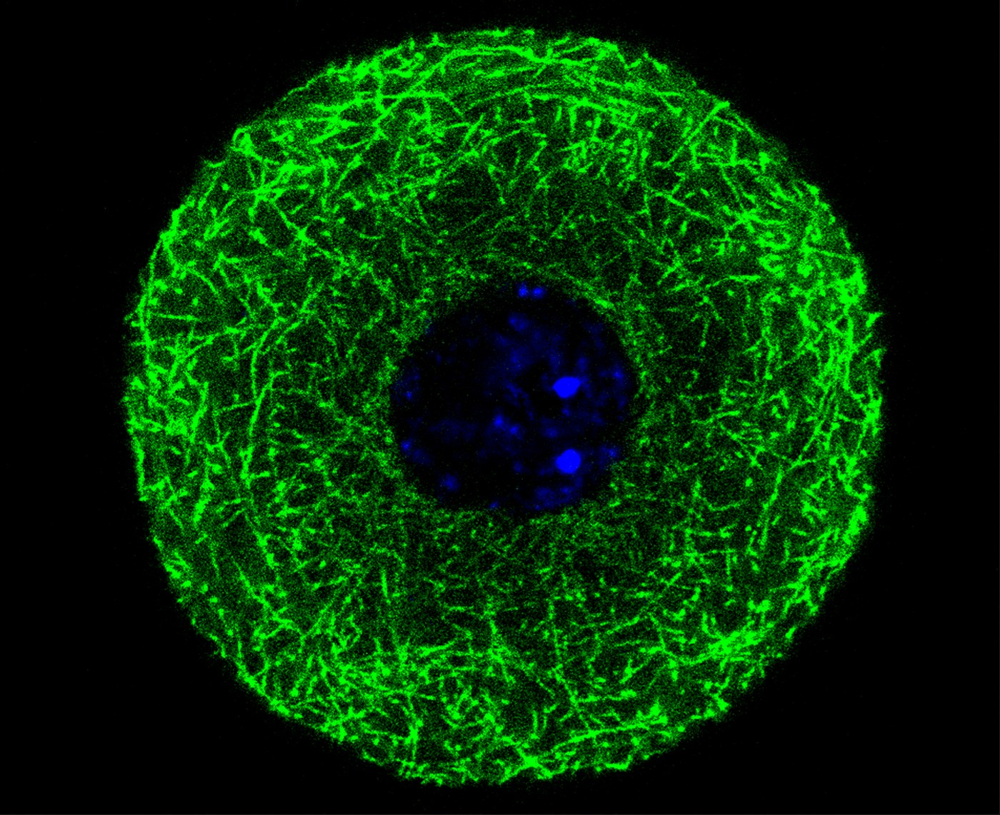

<figure class="fig-right">
  
  <figcaption>A growing mouse oocyte: microtubules (green) and nucleus (blue).</figcaption>
</figure>

The microtubules in oocytes of primordial follicles likely contribute to the rotation of the oocyte nucleus (<a id="cite1" href="#ref1">1</a>). These microtubules may emanate from microtubule-organizing centers (MTOCs) or centrioles (<a id="cite2" href="#ref2">2</a>).

In oocytes of primary follicles, the microtubules are elongated and robust (<a href="#ref2">2</a>). The deposition of MTOC proteins, such as Aurora kinase A (Aurora A) and Polo-like kinase 1 (PLK1), contributes to this.

In oocytes of secondary follicles, the microtubules grow further and may interact extensively with cortical actin (<a id="cite3" href="#ref3">3</a>, <a id="cite4" href="#ref4">4</a>).

In oocytes of antral follicles, the microtubules become short. Do they have a role in the mitochondria-associated ribonucleoprotein domain (MARDO) (<a href="#ref2">2</a>, <a id="cite5" href="#ref5">5</a>)?

<strong>References</strong>

<ol style="padding-left: 1.4em; margin: 0;">
<li id="ref1" style="margin-bottom: 0.6em;">Nagamatsu G, Shimamoto S, Hamazaki N, Nishimura Y, Hayashi K. Mechanical stress accompanied with nuclear rotation is involved in the dormant state of mouse oocytes. <em>Sci Adv</em>. 2019 Jun 26;5(6):eaav9960. doi: <a href="https://doi.org/10.1126/sciadv.aav9960">10.1126/sciadv.aav9960</a>. PMID: 31249869; PMCID: PMC6594774. <a href="#cite1">↩</a></li>
<li id="ref2" style="margin-bottom: 0.6em;">Yin Q, Spradling AC. The mouse oocyte Balbiani body reassembles in growing follicles to continue organelle selection and upon dispersal influences nuclear position. <em>bioRxiv</em> [Preprint]. 2026 Sep 3:2026.09.02.748954. doi: <a href="https://doi.org/10.64898/2026.09.02.748954">10.64898/2026.09.02.748954</a>. <a href="#cite2">↩</a></li>
<li id="ref3" style="margin-bottom: 0.6em;">Uraji J, Scheffler K, Schuh M. Functions of actin in mouse oocytes at a glance. <em>J Cell Sci</em>. 2018 Nov 22;131(22):jcs218099. doi: <a href="https://doi.org/10.1242/jcs.218099">10.1242/jcs.218099</a>. PMID: 30467138. <a href="#cite3">↩</a></li>
<li id="ref4" style="margin-bottom: 0.6em;">Chou WC, Lakonishok M, Lu W, Gelfand VI, McCartney BM. Developmentally regulated actin-microtubule cross talk in <em>Drosophila</em> oogenesis. <em>J Cell Biol</em>. 2026 Mar 2;225(3):e202411007. doi: <a href="https://doi.org/10.1083/jcb.202411007">10.1083/jcb.202411007</a>. Epub 2026 Jan 9. PMID: 41511043. <a href="#cite4">↩</a></li>
<li id="ref5" style="margin-bottom: 0.6em;">Cheng S, Altmeppen G, So C, Welp LM, Penir S, Ruhwedel T, Menelaou K, Harasimov K, Stützer A, Blayney M, Elder K, Möbius W, Urlaub H, Schuh M. Mammalian oocytes store mRNAs in a mitochondria-associated membraneless compartment. <em>Science</em>. 2022 Oct 21;378(6617):eabq4835. doi: <a href="https://doi.org/10.1126/science.abq4835">10.1126/science.abq4835</a>. Epub 2022 Oct 21. PMID: 36264786. <a href="#cite5">↩</a></li>
</ol>

<em>AI tools were used to improve the grammar and flow of this post. The author takes full responsibility for its content.</em>

