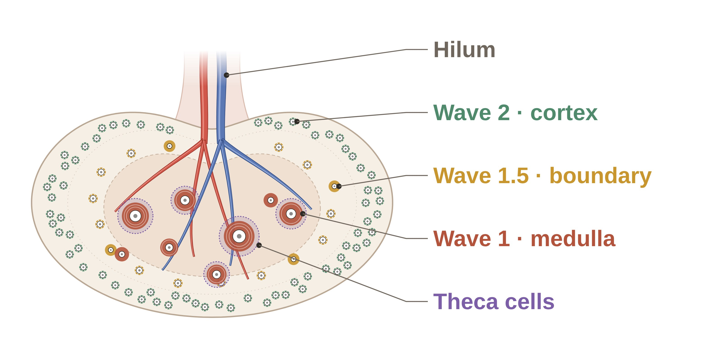

<figure class="fig-right">
  
  <figcaption>Figure 1. Distinct waves of follicles in the mouse ovary at about 2 weeks of age. Schematic drawn with Claude (AI), based on Yin &amp; Spradling, <em>eLife</em> 2025.</figcaption>
</figure>

It has been documented that the mouse ovary, and the ovaries of other species, contain distinct waves of follicles (1, 2). Both histology and lineage tracing show that the two waves are clearly different: wave 1 follicles are activated around birth, whereas wave 2 follicles are activated later (3, 4). Some studies suggest that wave 2 begins around two weeks of age, but this has not been firmly established (2). Because ovulation does not occur at these early stages, wave 1 follicles do not seem to fulfill their expected destiny of producing eggs (2, 4). In our recent study, we found that the main function of wave 1 is not to produce oocytes, but to produce somatic cells (4).

The ovary and the testis each contain three corresponding cell types, and each pair arises from a common precursor: germ cells (oocytes in females, male germ cells in males), supporting cells (granulosa cells and Sertoli cells), and steroidogenic cells (theca cells and Leydig cells). However, there are important differences between the sexes. In males, germ cells give rise to spermatogonial stem cells, whereas females do not maintain germline stem cells (5). Sertoli cells appear to consist mainly of one population (wave 1-like), with only a small population of a different origin in the rete testis (wave 2-like) (6, 7). In contrast, granulosa cells come from two sources: bipotential pre-granulosa cells (BPG; wave 1, fewer cells) and epithelial pre-granulosa cells (EPG; wave 2, more cells) (3). This difference is very interesting. In both sexes, the steroidogenic cells depend on signals from the supporting cells: Sertoli cells induce Leydig cells, and granulosa cells induce theca cells (8, 9). Both Leydig and theca cells produce androgens, and the timing of androgen production is important for sexual differentiation (10).

Around puberty, oocytes that reach the antral stage but do not receive gonadotropin signals undergo atresia, and their granulosa cells follow (4, 11). The theca cells, however, do not die. Instead, they begin to store lipid droplets (4, 11). This could result from increased uptake of lipids, for example through higher expression of lipid uptake receptors on the theca cell surface, or from reduced use of lipids for androgen synthesis. Our single-cell sequencing data do not clearly support either explanation, but it has to be one of them (4). In both sexes, androgens circulate at higher levels than estrogens, even before puberty, suggesting that they have important functions (12). Androgens are also important for neural development (13), which raises a speculative question: could the timing of androgen production influence brain development, and even human evolution?

The current model, in which BPG-derived follicles form wave 1 and are activated around birth while EPG-derived follicles form wave 2 and are activated later, deserves a second look. We think the timing is less strict: some follicles with BPG-derived granulosa cells appear to remain dormant at the primordial stage even at two weeks of age. There may be no rigid rule governing when these follicles develop (4).

So many interesting questions remain unanswered.

<strong>References</strong>

<ol style="padding-left: 1.4em; margin: 0;">
<li style="margin-bottom: 0.6em;">Hirshfield AN. Heterogeneity of cell populations that contribute to the formation of primordial follicles in rats. <em>Biol Reprod</em>. 1992 Sep;47(3):466-72. doi: 10.1095/biolreprod47.3.466. PMID: 1511099.</li>
<li style="margin-bottom: 0.6em;">Zheng W, Zhang H, Gorre N, Risal S, Shen Y, Liu K. Two classes of ovarian primordial follicles exhibit distinct developmental dynamics and physiological functions. <em>Hum Mol Genet</em>. 2014 Feb 15;23(4):920-8. doi: 10.1093/hmg/ddt486. Epub 2013 Oct 1. PMID: 24087793; PMCID: PMC3900105.</li>
<li style="margin-bottom: 0.6em;">Niu W, Spradling AC. Two distinct pathways of pregranulosa cell differentiation support follicle formation in the mouse ovary. <em>Proc Natl Acad Sci U S A</em>. 2020 Aug 18;117(33):20015-20026. doi: 10.1073/pnas.2005570117. Epub 2020 Aug 5. PMID: 32759216; PMCID: PMC7443898.</li>
<li style="margin-bottom: 0.6em;">Yin Q, Spradling AC. Distinct waves of ovarian follicles contribute to mouse oocyte production. <em>Elife</em>. 2025 Oct 7;14:RP107352. doi: 10.7554/eLife.107352. PMID: 41055104; PMCID: PMC12503487.</li>
<li style="margin-bottom: 0.6em;">Lei L, Spradling AC. Female mice lack adult germ-line stem cells but sustain oogenesis using stable primordial follicles. <em>Proc Natl Acad Sci U S A</em>. 2013 May 21;110(21):8585-90. doi: 10.1073/pnas.1306189110. Epub 2013 Apr 29. PMID: 23630252; PMCID: PMC3666718.</li>
<li style="margin-bottom: 0.6em;">Karl J, Capel B. Sertoli cells of the mouse testis originate from the coelomic epithelium. <em>Dev Biol</em>. 1998 Nov 15;203(2):323-33. doi: 10.1006/dbio.1998.9068. PMID: 9808783.</li>
<li style="margin-bottom: 0.6em;">Mayère C, Regard V, Perea-Gomez A, Bunce C, Neirijnck Y, Djari C, Bellido-Carreras N, Sararols P, Reeves R, Greenaway S, Simon M, Siggers P, Condrea D, Kühne F, Gantar I, Tang F, Stévant I, Batti L, Ghyselinck NB, Wilhelm D, Greenfield A, Capel B, Chaboissier MC, Nef S. Origin, specification and differentiation of a rare supporting-like lineage in the developing mouse gonad. <em>Sci Adv</em>. 2022 May 27;8(21):eabm0972. doi: 10.1126/sciadv.abm0972. Epub 2022 May 25. PMID: 35613264; PMCID: PMC10942771.</li>
<li style="margin-bottom: 0.6em;">Yao HH, Whoriskey W, Capel B. Desert Hedgehog/Patched 1 signaling specifies fetal Leydig cell fate in testis organogenesis. <em>Genes Dev</em>. 2002 Jun 1;16(11):1433-40. doi: 10.1101/gad.981202. PMID: 12050120; PMCID: PMC186321.</li>
<li style="margin-bottom: 0.6em;">Liu C, Peng J, Matzuk MM, Yao HH. Lineage specification of ovarian theca cells requires multicellular interactions via oocyte and granulosa cells. <em>Nat Commun</em>. 2015 Apr 28;6:6934. doi: 10.1038/ncomms7934. PMID: 25917826; PMCID: PMC4413950.</li>
<li style="margin-bottom: 0.6em;">Miyagawa S, Satoh Y, Haraguchi R, Suzuki K, Iguchi T, Taketo MM, Nakagata N, Matsumoto T, Takeyama K, Kato S, Yamada G. Genetic interactions of the androgen and Wnt/beta-catenin pathways for the masculinization of external genitalia. <em>Mol Endocrinol</em>. 2009 Jun;23(6):871-80. doi: 10.1210/me.2008-0478. Epub 2009 Mar 12. PMID: 19282366; PMCID: PMC2725765.</li>
<li style="margin-bottom: 0.6em;">Hsueh AJ, Billig H, Tsafriri A. Ovarian follicle atresia: a hormonally controlled apoptotic process. <em>Endocr Rev</em>. 1994 Dec;15(6):707-24. doi: 10.1210/edrv-15-6-707. PMID: 7705278.</li>
<li style="margin-bottom: 0.6em;">Greenblatt RB, Oettinger M, Bohler CS. Estrogen-androgen levels in aging men and women: therapeutic considerations. <em>J Am Geriatr Soc</em>. 1976 Apr;24(4):173-8. doi: 10.1111/j.1532-5415.1976.tb04294.x. PMID: 1254880.</li>
<li style="margin-bottom: 0.6em;">Kelava I, Chiaradia I, Pellegrini L, Kalinka AT, Lancaster MA. Androgens increase excitatory neurogenic potential in human brain organoids. <em>Nature</em>. 2022 Feb;602(7895):112-116. doi: 10.1038/s41586-021-04330-4. Epub 2022 Jan 19. PMID: 35046577; PMCID: PMC7612328.</li>

<em>AI tools were used to improve the grammar and flow of this post. The author takes full responsibility for its content.</em>

</ol>

