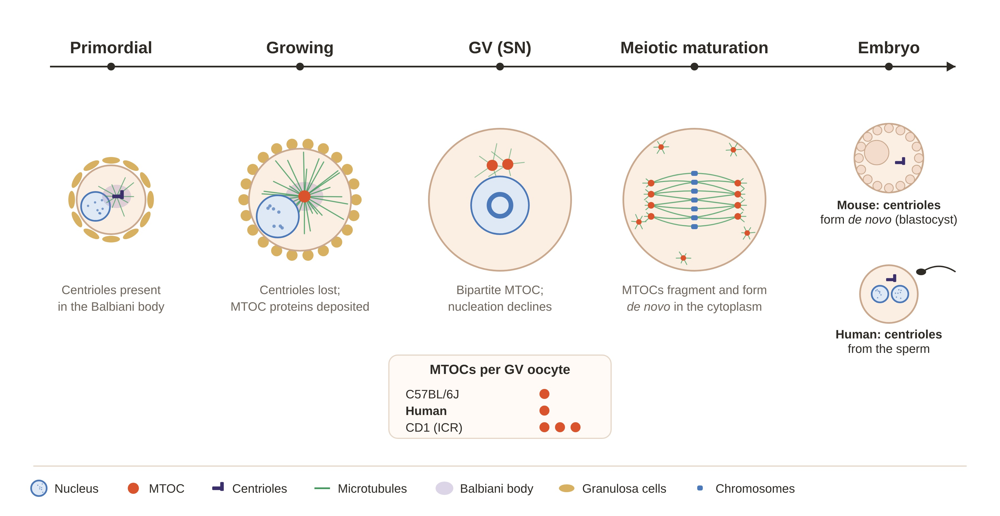

<figure class="fig-right fig-small">
  
  <figcaption>MTOCs during mouse oocyte development. Schematic drawn with Claude (AI)</figcaption>
</figure>

Microtubule-organizing centers (MTOCs) in mouse oocytes have been studied for a long time, but their basic features remained disputed until the recent study by Gu et al. (2025) (<a id="cite1" href="#ref1">1</a>). Even the number of MTOCs was an open question (<a id="cite2" href="#ref2">2</a>, <a id="cite3" href="#ref3">3</a>). Gu et al. (2025) carried out a thorough investigation and found that MTOC number differs between mouse strains: C57BL/6J oocytes, like human oocytes (<a id="cite4" href="#ref4">4</a>), contain one MTOC, whereas CD1 (ICR) oocytes contain three (<a href="#ref1">1</a>). New MTOCs can form during meiotic maturation (<a id="cite5" href="#ref5">5</a>), but whether the original MTOC is required for later meiotic maturation or for embryonic development is unknown.

At least dozens of proteins have been identified in the MTOCs of mouse and human oocytes (<a href="#ref1">1</a>, <a id="cite6" href="#ref6">6</a>), but how these proteins are arranged is still unknown. Centrioles have been identified in oocytes of primordial follicles (<a id="cite7" href="#ref7">7</a>, <a id="cite8" href="#ref8">8</a>), whereas centrioles have not been reported in the MTOCs of oocytes in later, growing follicles (<a id="cite9" href="#ref9">9</a>, <a id="cite10" href="#ref10">10</a>). How is this transition achieved?

In GV oocytes at the SN stage, the MTOC often has a bipartite shape (<a href="#ref2">2</a>). Why do CD1 oocytes have three MTOCs, whereas C57BL/6J oocytes have only one? I could understand two, but why three?

During oocyte growth, the deposition of proteins onto the MTOC may increase its ability to nucleate microtubules. However, at the later SN stage, the microtubule-organizing ability of the MTOC seems to decline compared with earlier stages (<a href="#ref1">1</a>). How does this happen?

The de novo formation of MTOCs during meiotic maturation (<a href="#ref5">5</a>) suggests that MTOC proteins are already present in the cytoplasm, but in small amounts (<a href="#ref3">3</a>, <a id="cite11" href="#ref11">11</a>). How is this achieved, and when do these MTOCs form?

In mouse embryos, centrioles form de novo at the blastocyst stage (<a id="cite12" href="#ref12">12</a>), whereas in human embryos, centrioles are contributed by the sperm (<a id="cite13" href="#ref13">13</a>, <a id="cite14" href="#ref14">14</a>). Why do the two species differ?

Many more questions remain to be answered.

<strong>References</strong>

<ol style="padding-left: 1.4em; margin: 0;">
<li id="ref1" style="margin-bottom: 0.6em;">Gu H, Wu L, Yin M, Du X, Fu J, Xu F, Ye Z, Zhang X, Jing H, Luo Y, Li W, Sun X, He L, Kuang Y, Lyu Q, Wu T, Wang L, Sang Q. The mechanisms of MTOCs maturation in human and mouse oocytes. <em>Sci Bull (Beijing)</em>. 2025 Oct 15;70(19):3202–3214. doi: <a href="https://doi.org/10.1016/j.scib.2025.08.012">10.1016/j.scib.2025.08.012</a>. PMID: 40903356. <a href="#cite1">↩</a></li>
<li id="ref2" style="margin-bottom: 0.6em;">Calarco PG. Centrosome precursors in the acentriolar mouse oocyte. <em>Microsc Res Tech</em>. 2000 Jun 1;49(5):428–434. doi: <a href="https://doi.org/10.1002/(SICI)1097-0029(20000601)49:5%3C428::AID-JEMT4%3E3.0.CO;2-K">10.1002/(SICI)1097-0029(20000601)49:5&lt;428::AID-JEMT4&gt;3.0.CO;2-K</a>. PMID: 10842369. <a href="#cite2">↩</a></li>
<li id="ref3" style="margin-bottom: 0.6em;">Luksza M, Queguigner I, Verlhac MH, Brunet S. Rebuilding MTOCs upon centriole loss during mouse oogenesis. <em>Dev Biol</em>. 2013 Oct 1;382(1):48–56. doi: <a href="https://doi.org/10.1016/j.ydbio.2013.07.029">10.1016/j.ydbio.2013.07.029</a>. PMID: 23954884. <a href="#cite3">↩</a></li>
<li id="ref4" style="margin-bottom: 0.6em;">Wu T, Dong J, Fu J, Kuang Y, Chen B, Gu H, Luo Y, Gu R, Zhang M, Li W, Dong X, Sun X, Sang Q, Wang L. The mechanism of acentrosomal spindle assembly in human oocytes. <em>Science</em>. 2022 Nov 18;378(6621):eabq7361. doi: <a href="https://doi.org/10.1126/science.abq7361">10.1126/science.abq7361</a>. PMID: 36395215. <a href="#cite4">↩</a></li>
<li id="ref5" style="margin-bottom: 0.6em;">Schuh M, Ellenberg J. Self-organization of MTOCs replaces centrosome function during acentrosomal spindle assembly in live mouse oocytes. <em>Cell</em>. 2007 Aug 10;130(3):484–498. doi: <a href="https://doi.org/10.1016/j.cell.2007.06.025">10.1016/j.cell.2007.06.025</a>. PMID: 17693257. <a href="#cite5">↩</a></li>
<li id="ref6" style="margin-bottom: 0.6em;">So C, Seres KB, Steyer AM, Mönnich E, Clift D, Pejkovska A, Möbius W, Schuh M. A liquid-like spindle domain promotes acentrosomal spindle assembly in mammalian oocytes. <em>Science</em>. 2019 Jun 28;364(6447):eaat9557. doi: <a href="https://doi.org/10.1126/science.aat9557">10.1126/science.aat9557</a>. PMID: 31249032; PMCID: PMC6629549. <a href="#cite6">↩</a></li>
<li id="ref7" style="margin-bottom: 0.6em;">Kloc M, Jaglarz M, Dougherty M, Stewart MD, Nel-Themaat L, Bilinski S. Mouse early oocytes are transiently polar: three-dimensional and ultrastructural analysis. <em>Exp Cell Res</em>. 2008 Oct 15;314(17):3245–3254. doi: <a href="https://doi.org/10.1016/j.yexcr.2008.07.007">10.1016/j.yexcr.2008.07.007</a>. PMID: 18662685; PMCID: PMC2613006. <a href="#cite7">↩</a></li>
<li id="ref8" style="margin-bottom: 0.6em;">Yin Q, Spradling AC. The mouse oocyte Balbiani body reassembles in growing follicles to continue organelle selection and upon dispersal influences nuclear position. <em>bioRxiv</em> [Preprint]. 2026 Sep 3:2026.09.02.748954. doi: <a href="https://doi.org/10.64898/2026.09.02.748954">10.64898/2026.09.02.748954</a>. <a href="#cite8">↩</a></li>
<li id="ref9" style="margin-bottom: 0.6em;">Szollosi D, Calarco P, Donahue RP. Absence of centrioles in the first and second meiotic spindles of mouse oocytes. <em>J Cell Sci</em>. 1972 Sep;11(2):521–541. doi: <a href="https://doi.org/10.1242/jcs.11.2.521">10.1242/jcs.11.2.521</a>. PMID: 5076360. <a href="#cite9">↩</a></li>
<li id="ref10" style="margin-bottom: 0.6em;">Hertig AT, Adams EC. Studies on the human oocyte and its follicle. I. Ultrastructural and histochemical observations on the primordial follicle stage. <em>J Cell Biol</em>. 1967 Aug;34(2):647–675. doi: <a href="https://doi.org/10.1083/jcb.34.2.647">10.1083/jcb.34.2.647</a>. PMID: 4292010; PMCID: PMC2107315. <a href="#cite10">↩</a></li>
<li id="ref11" style="margin-bottom: 0.6em;">Londoño-Vásquez D, Rodriguez-Lukey K, Behura SK, Balboula AZ. Microtubule organizing centers regulate spindle positioning in mouse oocytes. <em>Dev Cell</em>. 2022 Jan 24;57(2):197–211.e3. doi: <a href="https://doi.org/10.1016/j.devcel.2021.12.011">10.1016/j.devcel.2021.12.011</a>. PMID: 35030327; PMCID: PMC8792338. <a href="#cite11">↩</a></li>
<li id="ref12" style="margin-bottom: 0.6em;">Gueth-Hallonet C, Antony C, Aghion J, Santa-Maria A, Lajoie-Mazenc I, Wright M, Maro B. gamma-Tubulin is present in acentriolar MTOCs during early mouse development. <em>J Cell Sci</em>. 1993 May;105(Pt 1):157–166. doi: <a href="https://doi.org/10.1242/jcs.105.1.157">10.1242/jcs.105.1.157</a>. PMID: 8360270. <a href="#cite12">↩</a></li>
<li id="ref13" style="margin-bottom: 0.6em;">Sathananthan AH, Kola I, Osborne J, Trounson A, Ng SC, Bongso A, Ratnam SS. Centrioles in the beginning of human development. <em>Proc Natl Acad Sci U S A</em>. 1991 Jun 1;88(11):4806–4810. doi: <a href="https://doi.org/10.1073/pnas.88.11.4806">10.1073/pnas.88.11.4806</a>. PMID: 2052559; PMCID: PMC51755. <a href="#cite13">↩</a></li>
<li id="ref14" style="margin-bottom: 0.6em;">Li Z, Leng L, Zhai J, Wang X, Yang W, Wang S, Wan H, Zhang S, Gong F, Liao X, Li Y, Zeng Q, Chen Y, Xiang Z, Liu F, He F, Yang Y, Wang H, Xu X, Lin G, So C. Two distinct causes contribute to the low efficiency of human pre-implantation development. <em>Cell</em>. 2026 Jul 23;189(15):4685–4705.e10. doi: <a href="https://doi.org/10.1016/j.cell.2026.05.037">10.1016/j.cell.2026.05.037</a>. Epub 2026 Jun 11. PMID: 42276044. <a href="#cite14">↩</a></li>
</ol>

<em>AI tools were used to improve the grammar and flow of this text. The author takes full responsibility for its content.</em>

