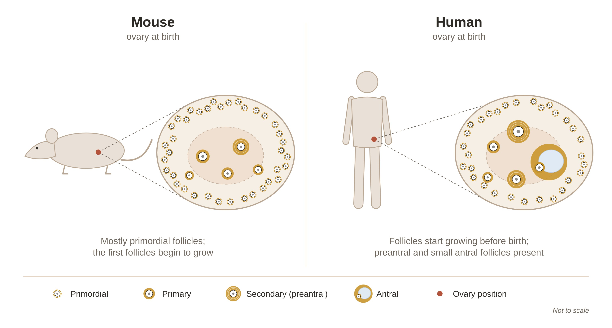

<figure class="fig-center fig-large">
  
  <figcaption>Mouse and human ovaries at birth. Schematic drawn with Claude (AI).</figcaption>
</figure>

While extensive studies have been performed in mice, research on other species seems to lag behind, or does it? Some would argue that it does not, since the human ovary, both fetal and adult, has been sequenced extensively (<a id="cite1" href="#ref1">1</a>, <a id="cite2" href="#ref2">2</a>, <a id="cite3" href="#ref3">3</a>, <a id="cite4" href="#ref4">4</a>). Each time a new method appears, researchers, from within the reproduction field and outside it, apply it to the ovary again and re-validate what is already known (<a id="cite5" href="#ref5">5</a>, <a id="cite6" href="#ref6">6</a>). Useful information can certainly be extracted from these data, but the field is swamped with sequencing data and relatively short of new insights.

In humans and nonhuman primates, unlike in mice, follicles begin to grow much earlier (<a id="cite7" href="#ref7">7</a>, <a id="cite8" href="#ref8">8</a>). The granulosa cells of these follicles could induce theca cell differentiation, allowing theca cells to synthesize androgens. However, <em>CYP19A1</em> (aromatase) is also expressed in pregranulosa cells (<a id="cite9" href="#ref9">9</a>). Are both androgens and estrogens being produced at this stage?

Direct studies of human and nonhuman primate ovaries would help us understand ourselves better.

<strong>References</strong>

<ol style="padding-left: 1.4em; margin: 0;">
<li id="ref1" style="margin-bottom: 0.6em;">Wagner M, Yoshihara M, Douagi I, Damdimopoulos A, Panula S, Petropoulos S, Lu H, Pettersson K, Palm K, Katayama S, Hovatta O, Kere J, Lanner F, Damdimopoulou P. Single-cell analysis of human ovarian cortex identifies distinct cell populations but no oogonial stem cells. <em>Nat Commun</em>. 2020 Mar 2;11(1):1147. doi: <a href="https://doi.org/10.1038/s41467-020-14936-3">10.1038/s41467-020-14936-3</a>. PMID: 32123174; PMCID: PMC7052271. <a href="#cite1">↩</a></li>
<li id="ref2" style="margin-bottom: 0.6em;">Wamaitha SE, Nie X, Pandolfi EC, Wang X, Yang Y, Stukenborg JB, Cairns BR, Guo J, Clark AT. Single-cell analysis of the developing human ovary defines distinct insights into ovarian somatic and germline progenitors. <em>Dev Cell</em>. 2023 Oct 23;58(20):2097–2111.e3. doi: <a href="https://doi.org/10.1016/j.devcel.2023.07.014">10.1016/j.devcel.2023.07.014</a>. Epub 2023 Aug 14. PMID: 37582368; PMCID: PMC10615783. <a href="#cite2">↩</a></li>
<li id="ref3" style="margin-bottom: 0.6em;">Jones ASK, Hannum DF, Machlin JH, Tan A, Ma Q, Ulrich ND, Shen YC, Ciarelli M, Padmanabhan V, Marsh EE, Hammoud S, Li JZ, Shikanov A. Cellular atlas of the human ovary using morphologically guided spatial transcriptomics and single-cell sequencing. <em>Sci Adv</em>. 2024 Apr 5;10(14):eadm7506. doi: <a href="https://doi.org/10.1126/sciadv.adm7506">10.1126/sciadv.adm7506</a>. Epub 2024 Apr 5. PMID: 38578993; PMCID: PMC10997207. <a href="#cite3">↩</a></li>
<li id="ref4" style="margin-bottom: 0.6em;">McGlacken-Byrne SM, Del Valle I, Xenakis T, Simcock IC, Suntharalingham JP, Buonocore F, Crespo B, Moreno N, Liptrot D, Niola P, Brooks T, Conway GS, Dattani MT, Arthurs OJ, Solanky N, Achermann JC. Mapping the anatomical and transcriptional landscape of early human fetal ovary development. <em>Sci Rep</em>. 2025 May 6;15(1):15814. doi: <a href="https://doi.org/10.1038/s41598-025-96135-y">10.1038/s41598-025-96135-y</a>. PMID: 40328871; PMCID: PMC12055976. <a href="#cite4">↩</a></li>
<li id="ref5" style="margin-bottom: 0.6em;">Zhang Y, Yan Z, Qin Q, Nisenblat V, Chang HM, Yu Y, Wang T, Lu C, Yang M, Yang S, Yao Y, Zhu X, Xia X, Dang Y, Ren Y, Yuan P, Li R, Liu P, Guo H, Han J, He H, Zhang K, Wang Y, Wu Y, Li M, Qiao J, Yan J, Yan L. Transcriptome landscape of human folliculogenesis reveals oocyte and granulosa cell interactions. <em>Mol Cell</em>. 2018 Dec 20;72(6):1021–1034.e4. doi: <a href="https://doi.org/10.1016/j.molcel.2018.10.029">10.1016/j.molcel.2018.10.029</a>. Epub 2018 Nov 21. PMID: 30472193. <a href="#cite5">↩</a></li>
<li id="ref6" style="margin-bottom: 0.6em;">Wu M, Tang W, Chen Y, Xue L, Dai J, Li Y, Zhu X, Wu C, Xiong J, Zhang J, Wu T, Zhou S, Chen D, Sun C, Yu J, Li H, Guo Y, Huang Y, Zhu Q, Wei S, Zhou Z, Wu M, Li Y, Xiang T, Qiao H, Wang S. Spatiotemporal transcriptomic changes of human ovarian aging and the regulatory role of FOXP1. <em>Nat Aging</em>. 2024 Apr;4(4):527–545. doi: <a href="https://doi.org/10.1038/s43587-024-00607-1">10.1038/s43587-024-00607-1</a>. Epub 2024 Apr 9. PMID: 38594460; PMCID: PMC11031396. <a href="#cite6">↩</a></li>
<li id="ref7" style="margin-bottom: 0.6em;">Overland MR, Li Y, Derpinghaus A, Aksel S, Cao M, Ladwig N, Cunha GR, Himelreich-Perić M, Baskin LS. Development of the human ovary: Fetal through pubertal ovarian morphology, folliculogenesis and expression of cellular differentiation markers. <em>Differentiation</em>. 2023 Jan–Feb;129:37–59. doi: <a href="https://doi.org/10.1016/j.diff.2022.10.005">10.1016/j.diff.2022.10.005</a>. Epub 2022 Oct 19. PMID: 36347737. <a href="#cite7">↩</a></li>
<li id="ref8" style="margin-bottom: 0.6em;">Wamaitha SE, Rojas EJ, Monticolo F, Hsu FM, Sosa E, Mackie AM, Oyama K, Custer M, Murphy M, Laird DJ, Shu J, Hennebold JD, Clark AT. Defining the cell and molecular origins of the primate ovarian reserve. <em>Nat Commun</em>. 2025 Aug 26;16(1):7539. doi: <a href="https://doi.org/10.1038/s41467-025-62702-0">10.1038/s41467-025-62702-0</a>. PMID: 40858568; PMCID: PMC12381125. <a href="#cite8">↩</a></li>
<li id="ref9" style="margin-bottom: 0.6em;">Fowler PA, Anderson RA, Saunders PT, Kinnell H, Mason JI, Evans DB, Bhattacharya S, Flannigan S, Franks S, Monteiro A, O'Shaughnessy PJ. Development of steroid signaling pathways during primordial follicle formation in the human fetal ovary. <em>J Clin Endocrinol Metab</em>. 2011 Jun;96(6):1754–1762. doi: <a href="https://doi.org/10.1210/jc.2010-2618">10.1210/jc.2010-2618</a>. Epub 2011 Mar 23. PMID: 21430025. <a href="#cite9">↩</a></li>
</ol>

<em>AI tools were used to improve the grammar and flow of this text. The author takes full responsibility for its content.</em>
